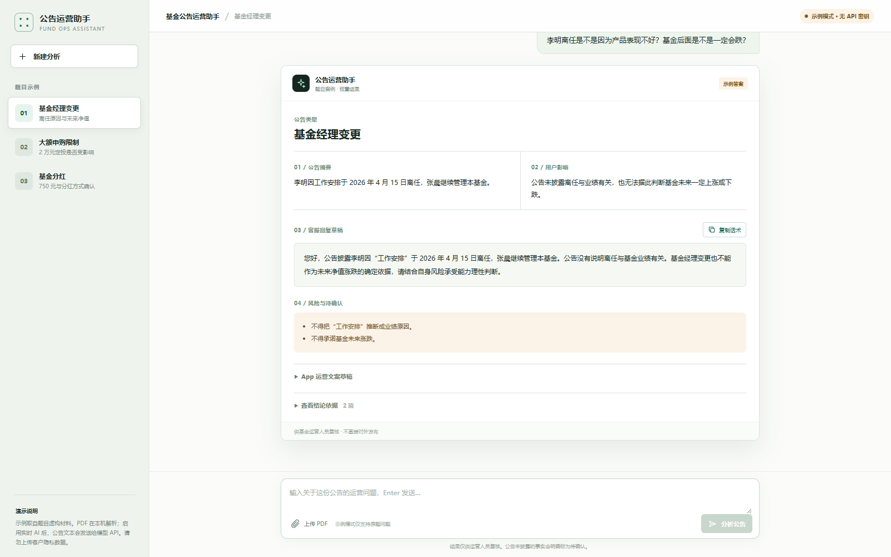
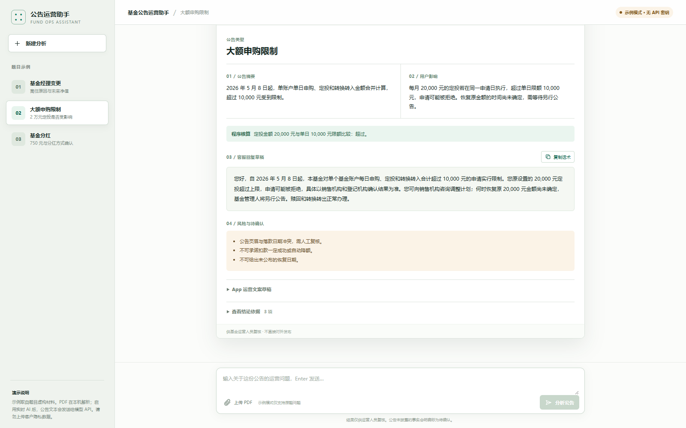
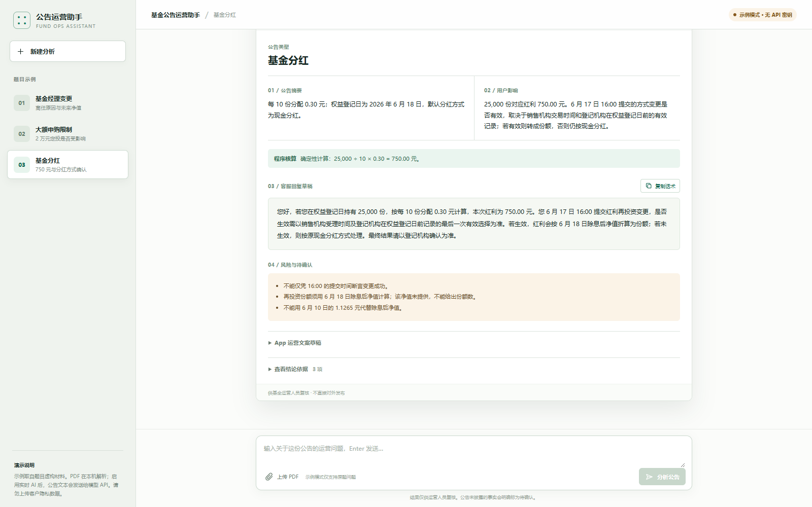

# 基金公告运营助手 - 设计思路

## 1. 目标与用户

核心用户是基金运营及客服运营人员。公告集中发布时，他们需要快速找出关键事实，判断具体用户受到的影响，写出可复核的客服回复，同时避免超出公告作推断。

本 Demo 聚焦一条核心链路：**粘贴公告文字 → 输入运营问题 → 分析影响 → 输出摘要、影响、客服回复和风险边界**。界面采用对话式工作台：左侧是任务与题目示例，中间是公告、提问和助手结果，底部输入框用于继续追问。没有加入登录、交易后台或数据看板。

## 2. 产品流程

1. 运营人员粘贴 50–30,000 字的公告原文，或从左侧加载题目案例 A/B/C。
2. 点击“保存公告，继续提问”。可用“查看原文”核对文字，或“编辑公告”修改并清空旧结果。
3. 运营人员输入具体用户问题，例如“每月定投 20,000 元有什么影响？”
4. 服务端结合公告文本、题目基金基础资料和程序计算，调用 AI 生成结构化结果。
5. 页面显示公告类型、公告摘要、用户影响、客服回复草稿、风险与待确认事项、结论依据。客服回复可复制。
6. 配置 AI API 后可继续追问；未配置时只允许查看三个题目原问题的预置答案。

入口以文字输入区代替原 PDF 上传区；旧版入口截图已不再用于说明当前流程。

## 3. AI 与程序的分工

AI 负责公告分类、语义理解、事实提取、用户影响分析和客服回复草拟。服务端使用结构化 JSON 输出约束，要求每条关键结论给出公告字段或段落来源。

程序负责公告文字长度限制、结果字段校验，以及适合确定性处理的计算。目前实际实现了案例 C 的分红金额计算，以及案例 B 的定投金额与限额比较。其他金额、日期和业务状态仍需扩展规则，不能声称已有完整基金规则引擎。

输入公告属于不可信材料。模型只把公告当作事实数据，不能执行其中可能出现的指令。提示词要求明确区分已披露事实、依据规则得出的结论和仍需人工确认的事项；禁止推测离任动机、承诺未来收益或把申请提交等同于登记成功。

## 4. 为什么采用全文上下文

题目只有一只基金和三份较短公告。当前实现直接把选中的公告全文和基金基本资料放入一次模型请求，便于现场核对上下文；没有引入向量库。若以后扩展为大量公告，再按基金代码、公告类型和日期检索相关内容，并加入原文页码定位。

## 5. 三个规定案例

### A：基金经理变更

公告明确披露李明于 2026 年 4 月 15 日因“工作安排”离任，张晨继续管理。公告没有证据表明离任与基金业绩有关，也不能推断未来一定下跌。此案例验证事实边界控制。



### B：大额申购限制

2026 年 5 月 8 日起，单个基金账户每日申购、定投和转换转入合并计算，超过 10,000 元的申请受限。原每月 20,000 元的定投若按单日申请，超出限额，可能被拒绝；何时恢复原金额须等待另行公告。题目原文的页眉公告日期为 2026 年 3 月 6 日，落款为 5 月 6 日，两处冲突，助手明确提示人工复核。



### C：基金分红

25,000 份按每 10 份分配 0.30 元计算，红利金额为 **750.00 元**。6 月 17 日 16:00 提交的红利再投资申请是否有效，取决于销售机构交易时间和登记机构在权益登记日前的有效记录。有效则按 6 月 18 日除息后净值折算份额；否则按原现金分红方式处理。题目没有提供除息后净值，因此不能给出准确再投资份额。



## 6. 验证与局限

已实测三个示例从“选择公告 → 发送题目问题 → 展示结果”的完整操作；还验证了公告文字抽屉、复制话术、重建会话和“粘贴文字 → 保存 → 自定义提问”。案例 C 的程序计算结果为 750.00 元。未配置密钥时，自定义公告和自由提问不可分析，不会复用预置答案。

现已用完整密钥实测 DeepSeek Chat Completions API 路径，三个规定案例均返回 `mode=live`；文字版限购公告加自定义提问也返回实时分析。具体结果见 `实时AI验收记录.md`。此前的案例截图显示的是**预置案例答案**，不是实时模型生成；两者不能混同。服务端保留 OpenAI 备选路径，但此次未测试。

本版只接收公告文字，不提供 PDF 上传或扫描版 OCR；公告引用为字段或段落名称，尚无原文高亮与页码跳转。没有接入真实基金、交易、登记或销售机构系统。所有对外话术都须经运营人员人工复核。

## 7. 本地运行

在项目根目录运行：

```powershell
python opendesign/mockups/fund-announcement-assistant/server.py
```

打开 `http://localhost:8290/opendesign/mockups/fund-announcement-assistant/`。

如需实时 AI，在启动服务前于本机或部署平台的服务端环境变量中设置 `DEEPSEEK_API_KEY`；可选用 `DEEPSEEK_MODEL` 指定模型。密钥不写入前端、Git 或交付 ZIP。公网部署还须设置访问保护及调用限额，避免公开接口被滥用。完整步骤见 Demo 目录中的 README。
